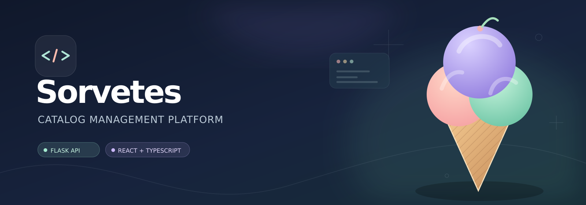

# 🍦 Sorvetes — Plataforma de Catálogo

> Sistema Full Stack para gerenciar fabricantes e sorvetes, com interface responsiva, API REST e persistência relacional.

[](https://github.com/egonschneider08-sketch/sorvete-flask-api/actions/workflows/ci.yml)


## O que é

O Sorvetes é uma aplicação web para organizar um catálogo de fabricantes e seus sorvetes. Foi desenvolvido como projeto de engenharia de software e portfólio, com preocupação em testes, qualidade, documentação e evolução.

**Funcionalidades disponíveis:**
- Cadastro e login com perfis de cliente (somente leitura) e administrador (gestão).
- Dashboard com indicadores reais de fabricantes, produtos e sabores.
- CRUD de fabricantes e sorvetes.
- Busca por nome e filtro de sorvetes por fabricante.
- Formulários com validação, erros, carregamento e confirmação de exclusão.
- Regras de integridade: não excluir fabricante com produtos associados.
- Testes automáticos de backend/frontend e build verificado no GitHub Actions.

**Escopo:** MVP para desenvolvimento local. A autenticação e as permissões estão implementadas, mas ainda faltam controle de tentativas, verificação de e-mail, recuperação de senha e revisão de segurança antes de uma publicação pública.

## Tecnologias

| Camada | Stack |
| --- | --- |
| Frontend | React, TypeScript, Vite, Tailwind CSS, React Router |
| Dados no frontend | TanStack Query, React Hook Form, Zod |
| Backend | Python, Flask, Blueprints, SQLAlchemy, Flask-Migrate |
| Banco | SQLite local; opção PostgreSQL configurável |
| Qualidade | pytest, Vitest, Testing Library, GitHub Actions |

## Executar localmente

### 1. Baixar o código

```powershell
git clone https://github.com/egonschneider08-sketch/sorvete-flask-api.git
cd sorvete-flask-api
```

### 2. Preparar o backend e criar o administrador (terminal A)

```powershell
py -m venv .venv
.\.venv\Scripts\Activate.ps1
python -m pip install -r requirements-api.txt
python -m flask --app app create-admin
python -m flask --app app run --debug
```

API: **http://127.0.0.1:5000/health**.

O comando `create-admin` é interativo e deve ser executado **antes** de iniciar o servidor. Ele solicita nome, e-mail e senha; contas públicas são exclusivamente de leitura. Se já existe administrador, não repita esse passo.

### 3. Iniciar o frontend (terminal B)

```powershell
cd frontend
npm install
npm run dev
```

Aplicação: **http://127.0.0.1:5173**. Abra **/cadastro** para criar conta de cliente ou **/entrar** para utilizar uma conta existente.

O Vite encaminha `/api` para Flask na porta 5000, sem precisar abrir CORS para qualquer origem.

## Como testar

```powershell
# Na raiz
python -m pip install -r requirements-dev.txt
python -m pytest -q

# Em frontend/
npm test
npm run build
```

A CI executa testes em Python 3.10 e 3.12, além dos testes e build Node 22.

## Acesso e permissões

- **Cliente:** cria conta, entra, consulta fabricantes e sorvetes. Não pode alterar os dados.
- **Admin:** conta criada no servidor pela CLI; pode cadastrar, editar e excluir produtos.
- O Flask exige token CSRF nas requisições de escrita, incluindo login e cadastro; o frontend gerencia o token automaticamente.
- Consulte [autenticação e segurança](docs/AUTH.md) antes de implantar.

## Rotas HTTP

| Método | Endpoint | Descrição |
| --- | --- | --- |
| GET | /health | Verificação de conexão (pública) |
| GET | /auth/session | Consulta de sessão e token CSRF |
| POST | /auth/register, /auth/login, /auth/logout | Cadastro, login e saída |
| GET, POST | /fabricantes | Listagem e cadastro |
| GET, PATCH, DELETE | /fabricantes/{id} | Consulta, edição e exclusão |
| GET, POST | /sorvetes | Listagem, filtros e cadastro |
| GET, PATCH, DELETE | /sorvetes/{id} | Consulta, edição e exclusão |

Todas as rotas de catálogo exigem login; apenas administradores podem modificar os dados. Detalhes: [Referência da API](docs/API.md) e [Autenticação](docs/AUTH.md).

## Estrutura

```text
app.py                      # Flask application factory
routes/                     # Blueprints e utilitários HTTP
models/                     # Modelos ORM
db.py                       # Extensão SQLAlchemy
frontend/                   # React, TypeScript, componentes e páginas
tests/                      # Testes do backend
docs/                       # API, arquitetura, guia de execução, roadmap
.github/workflows/          # CI para backend e frontend
```

## Documentação

- [Guia completo de instalação](docs/SETUP_FULLSTACK.md)
- [Cadastro, login e perfis](docs/AUTH.md)
- [Arquitetura e decisões](docs/ARCHITECTURE.md)
- [Contrato da API](docs/API.md)
- [Roadmap](docs/ROADMAP.md)
- [Como contribuir](CONTRIBUTING.md)
- [Central do projeto no Notion](https://app.notion.com/p/406f69f1ed0681e79d21f2ef6f160db5)

## Limitações atuais

A API possui autenticação inicial com sessão e perfis, ainda sem limitações de tentativas, confirmação de e-mail ou recuperação de senha. O campo `preco` é inteiro; esta interface exibe seu valor em reais inteiros para evitar modificar dados legados, mas a convenção precisa ser confirmada para uso com preços reais. O código mantém `db.create_all()` até uma estratégia de migrações ser implantada. A lista original `requirements.txt` é um snapshot de dependências legadas; utilize `requirements-api.txt` para a API e `requirements-dev.txt` para testes. A hospedagem em produção e o lockfile de dependências frontend estão no roadmap.

## Fluxo de contribuição

Abra uma issue, crie branch curta, adicione testes, atualize documentação e faça Pull Request. Os PRs [#3](https://github.com/egonschneider08-sketch/sorvete-flask-api/pull/3), [#5](https://github.com/egonschneider08-sketch/sorvete-flask-api/pull/5) e [#10](https://github.com/egonschneider08-sketch/sorvete-flask-api/pull/10) foram integrados à `main`. O [PR #12](https://github.com/egonschneider08-sketch/sorvete-flask-api/pull/12) também integrou cadastro, login e permissões. A implantação pública continua fora do escopo por faltar rate limiting, verificação de e-mail, recuperação de senha, auditoria e outros controles de segurança.
